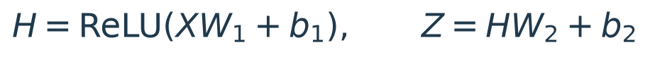
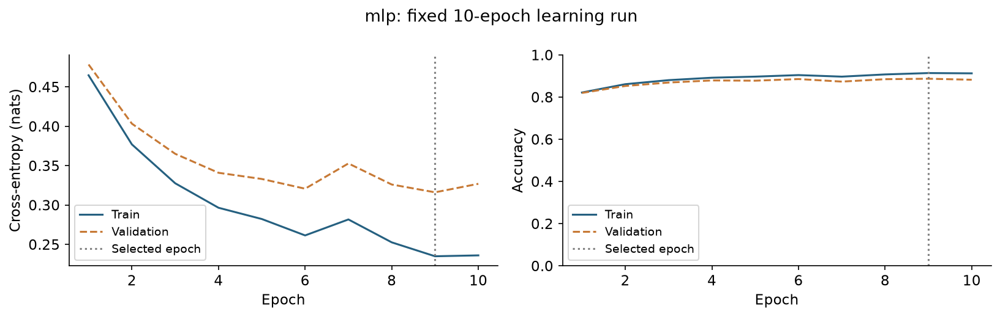
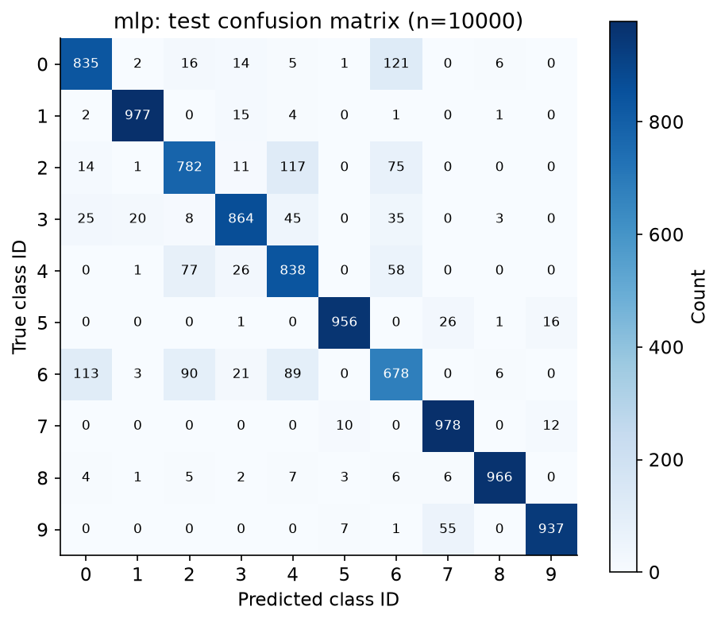
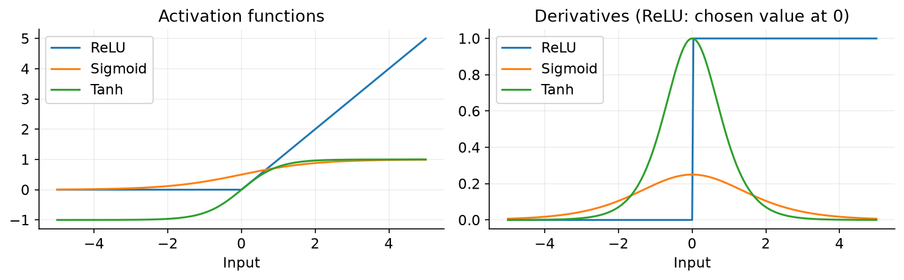

# 多层感知机：非线性表示与分类实验

从仿射映射的局限出发，整理隐藏层、非线性激活、链式法则和参数初始化，并通过Fashion-MNIST分类实验验证完整的训练与评估流程。

**[阅读完整技术笔记](notebooks/mlp.ipynb)** · [运行结果记录](results/mlp.json) · [来源与许可](THIRD_PARTY_NOTICES.md)

## 内容安排

| D2L对应内容 | 本项目整理范围 |
|---|---|
| 4.1 | 隐藏层、仿射复合与ReLU / Sigmoid / Tanh |
| 4.2—4.3 | 显式张量实现与模块实现对照 |
| 4.7—4.8（相关基础） | 反向传播、梯度核对、饱和与初始化 |

本文按教材概念顺序重新组织，补充数值核对、独立验证集和错误分析。实验采用直接可见的训练循环，不依赖`d2l`辅助包。未将4.4—4.6、4.9—4.10的完整专题纳入本项目。

## 数学模型




模型结构：`784 → 256 (ReLU) → 10`。可训练参数共 **203,530** 个。符号定义、维度检查与推导见Notebook。第二式中的G=(P−Y)/n，A=XW₁+b₁，φ为隐藏层激活函数。

## 实验设置

| 项目 | 设置 |
|---|---|
| 数据 | Fashion-MNIST，28×28灰度图，10类 |
| 参数训练 / 验证 / 测试 | 50,000 / 10,000 / 10,000 |
| 数据划分 | 官方训练集分层留出验证集；官方测试集不参与选择 |
| 预处理 | 像素除以255；无数据增强 |
| 优化器 | Adam，学习率0.003 |
| 批量大小 / 训练轮数 | 256 / 10 |
| 随机种子 | 划分41，初始化42，批次顺序44 |
| 模型选择 | 最低验证交叉熵对应的轮次 |
| 运行环境 | Python 3.13.9，PyTorch 2.14.1+cpu，CPU |

与D2L示例相比，本项目保留核心模型，采用Adam和独立验证集；因此结果不用于逐项复现教材中的准确率。模型选择完成后评估官方测试集，不以测试结果调参。训练曲线中的训练与验证指标均在每轮结束后，以同一组模型参数重新计算。

## 运行结果

| 指标 | 本次实测 |
|---|---:|
| 所选轮次 | 9 |
| 测试准确率 | 88.11% |
| 测试交叉熵（自然对数） | 0.341612 |
| 多数类基线准确率 | 10.00% |



本次固定运行选择第9轮，测试准确率为88.11%，测试交叉熵为0.3416。测试集中最频繁的单向混淆是T-shirt/top被预测为Shirt，共121张；这反映了本次模型与划分中的错误集中位置，不等于类别之间的普遍关系。



类别编号：0 T-shirt/top；1 Trouser；2 Pullover；3 Dress；4 Coat；5 Sandal；6 Shirt；7 Sneaker；8 Bag；9 Ankle boot。

## 激活函数及其导数



激活函数及其局部导数影响表达与反向传播；模型表现还取决于参数、数据和优化过程。

## 数值核对与结论边界

- 构造ReLU的XOR表示，验证非线性表达与仿射复合的差别。
- 显式张量实现与模块实现核对；手推链式法则与自动求导核对。
- 附录验证隐藏单元置换与相同单元合并的精确条件，不作为原创研究主张。
- 数据划分互斥、参数量、输出维度和混淆矩阵总数均在Notebook中检查。

本次为单随机种子实验，未估计跨种子的波动。测试准确率仅适用于当前数据与评估方式；没有对数据分布变化、概率校准或真实部署效果作保证。错误样例按固定测试顺序选取，保留在Notebook中。扩展实验应使用训练和验证数据，避免重复围绕测试集优化。

## 运行方式

```powershell
python -m venv .venv
.\.venv\Scripts\python.exe -m pip install -r requirements.txt
.\.venv\Scripts\python.exe -m jupyterlab
```

打开`notebooks/mlp.ipynb`，选择上述环境的Python内核，执行“Restart Kernel and Run All Cells”。第一次运行从数据集官方GitHub仓库下载约30MB压缩数据并校验MD5，缓存位于`data/`；也可用环境变量`FASHION_MNIST_CACHE`指定缓存目录。CPU可运行，无需GPU。Notebook已经保留运行结果，GitHub上可直接阅读。

也可用当前Python环境直接执行，脚本会临时创建内核配置，不修改现有Jupyter内核：

```powershell
.\.venv\Scripts\python.exe scripts/run_notebook.py
```

`requirements-lock.txt`记录本次验证的直接依赖版本；未单独验证全新环境安装。不同平台可能产生微小数值差异。重跑会更新Notebook、图表和结果文件；若修改参数，README中的表格与解释也应同步更新。`.ipynb`建议在Jupyter中编辑，避免直接修改底层JSON造成格式错误。

## 文件结构

```text
README.md
requirements.txt / requirements-lock.txt
notebooks/mlp.ipynb
src/fashion_data.py
scripts/run_notebook.py
figures/                 # 代码生成的公式及实验图
results/                 # 指标、划分索引、训练曲线与测试预测
licenses/                # 第三方许可原文
THIRD_PARTY_NOTICES.md
```

## 参考资料

《动手学深度学习》（Aston Zhang、Zachary C. Lipton、Mu Li、Alexander J. Smola），对应中文版第4.1—4.3、4.7—4.8相关基础节：

- [mlp](https://zh.d2l.ai/chapter_multilayer-perceptrons/mlp.html)
- [mlp-scratch](https://zh.d2l.ai/chapter_multilayer-perceptrons/mlp-scratch.html)
- [mlp-concise](https://zh.d2l.ai/chapter_multilayer-perceptrons/mlp-concise.html)
- [backprop](https://zh.d2l.ai/chapter_multilayer-perceptrons/backprop.html)
- [numerical-stability-and-init](https://zh.d2l.ai/chapter_multilayer-perceptrons/numerical-stability-and-init.html)

- [Fashion-MNIST数据集](https://github.com/zalandoresearch/fashion-mnist)，Han Xiao、Kashif Rasul、Roland Vollgraf。
- [PyTorch文档](https://docs.pytorch.org/docs/stable/index.html)。

AI辅助整理说明：笔记组织、代码实现和运行检查使用了AI辅助。项目为教材学习与实验整理，不主张模型或基础方法的原创性。
